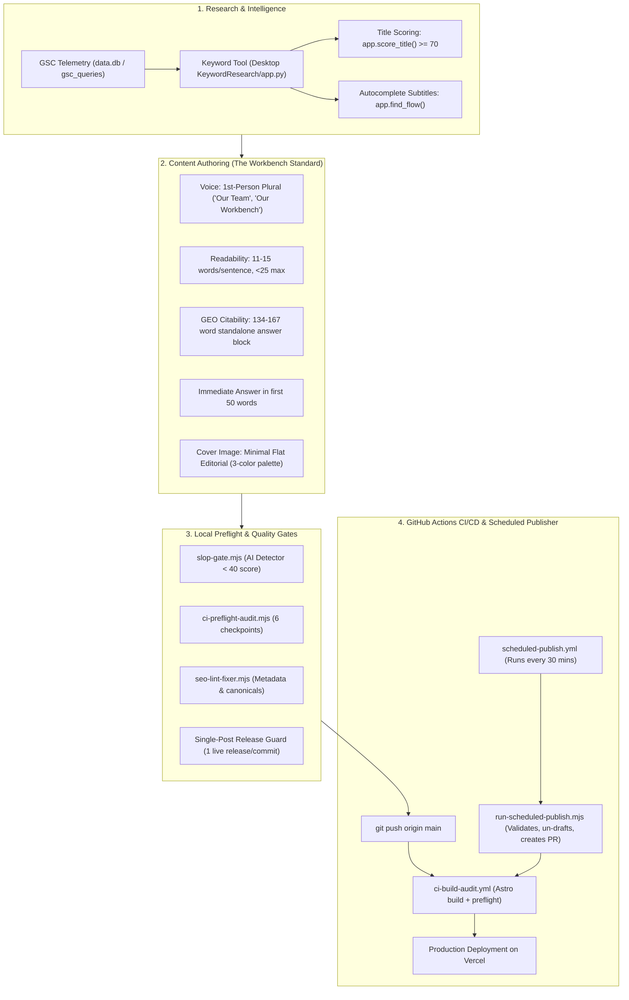
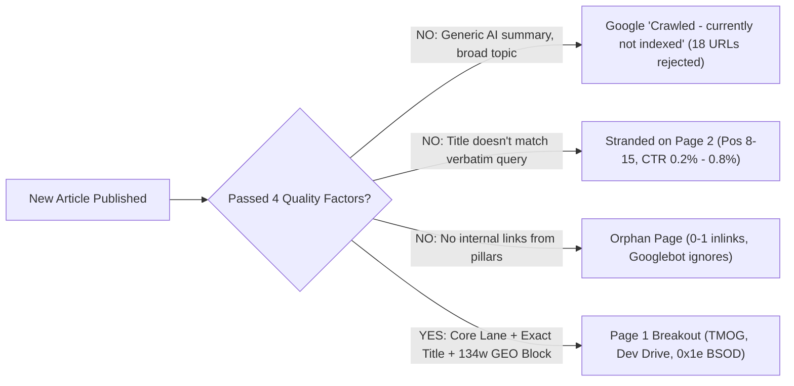

# PraveenTechWorld: In-Depth Project Architecture, Operational Audit & System Handoff

> **Author:** Antigravity Engineering & SEO Ops  
> **Date:** October 23, 2026  
> **Target Audience:** Engineering, SEO Strategists, and Autonomous Agent Harnesses  
> **Repository:** `codinginafk/PraveenTechWorldAstro`  
> **Status:** Active Operational Blueprint  

---

## Table of Contents
1. [Executive Summary & Project Identity](#1-executive-summary--project-identity)
2. [How Everything Works: Full System Architecture](#2-how-everything-works-full-system-architecture)
   - [2.1 Static Site & Build Engine (Astro 4+)](#21-static-site--build-engine-astro-4)
   - [2.2 Autonomous Agent & SEO Tooling Stack](#22-autonomous-agent--seo-tooling-stack)
   - [2.3 Quality Gates & Preflight Enforcement](#23-quality-gates--preflight-enforcement)
   - [2.4 Automated Scheduling & Release Engine](#24-automated-scheduling--release-engine)
3. [Where Things Fail: Bottlenecks, Ghosts & Ranking Traps](#3-where-things-fail-bottlenecks-ghosts--ranking-traps)
   - [3.1 Ghost Scripts & Abandoned Pipeline State](#31-ghost-scripts--abandoned-pipeline-state)
   - [3.2 The Silent Cron Failure Loop](#32-the-silent-cron-failure-loop)
   - [3.3 Why New Articles Aren't Ranking (The Harsh Truth)](#33-why-new-articles-arent-ranking-the-harsh-truth)
   - [3.4 The 301 Redirect Crawl Budget Trap (50 Broken Inlinks)](#34-the-301-redirect-crawl-budget-trap-50-broken-inlinks)
   - [3.5 Striking Distance Abandonment](#35-striking-distance-abandonment)
4. [What We Have Done: The Turnaround Actions](#4-what-we-have-done-the-turnaround-actions)
   - [4.1 The Three Core Priority Lanes](#41-the-three-core-priority-lanes)
   - [4.2 The Readability & Citability Standard](#42-the-readability--citability-standard)
   - [4.3 High-Impact Surgical Upgrades (October 2026)](#43-high-impact-surgical-upgrades-october-2026)
   - [4.4 Durable Project Memory System](#44-durable-project-memory-system)
5. [Where Things Are Heading: Strategic Vision](#5-where-things-are-heading-strategic-vision)
6. [Prioritized Execution Checklist](#6-prioritized-execution-checklist)

---

## 1. Executive Summary & Project Identity

### What is PraveenTechWorld?
PraveenTechWorld (`praveentechworld.com`) is a technical publishing platform built with Astro, TypeScript, Tailwind CSS, and MDX, deployed on Vercel. The domain is **19 months old**. As of October 23, 2026, the content repository consists of:
* **201 Total MDX Articles:** 171 Live (Published) and 30 Drafts.
* **Core North Star Goal:** Achieve **10,000 monthly organic search clicks** and **100,000 monthly search impressions**.
* **Current Telemetry Reality:** The site generates approximately **70–75 clicks per day** (~2,100 to 2,250 clicks/month). 

```
                                  CURRENT DOMAIN CTR CONCENTRATION
┌────────────────────────────────────────────────────────────────────────────────────────┐
│ [████████████████████████████████████████████████████████████████░░░░░░░░░░] ~88.9%   │
│  DeGoogle & Privacy Cluster (degoogle-starter-pack @ 34.4% CTR, Pos 1.2)               │
├────────────────────────────────────────────────────────────────────────────────────────┤
│ [████░░░░░░░░░░░░░░░░░░░░░░░░░░░░░░░░░░░░░░░░░░░░░░░░░░░░░░░░░░░░░░░░░░░░░░] ~7.5%    │
│  TMOG & Task Manager Cluster (10.7k impressions, Pos 6.4, CTR 0.8% -> upgrading)      │
├────────────────────────────────────────────────────────────────────────────────────────┤
│ [█░░░░░░░░░░░░░░░░░░░░░░░░░░░░░░░░░░░░░░░░░░░░░░░░░░░░░░░░░░░░░░░░░░░░░░░░] ~3.6%    │
│  Remaining 169 Articles Combined (Windows Fixes, WSL, Hardware, Cloud, General IT)    │
└────────────────────────────────────────────────────────────────────────────────────────┘
```

### The Fundamental Dilemma
For months, the site followed a high-frequency publication strategy, releasing articles across broad tech subjects (AI news, student grade scripts, generic office automation, GA4 setup, IT tips). While this generated over 200 files, **it severely diluted domain topical authority**. 
* Google Search Console (GSC) categorized 18 URLs as `Crawled - currently not indexed` and rejected indexing due to perceived lack of depth or duplicate search intent.
* Over 100 articles generate near-zero impressions.
* **The Moat:** Google views PraveenTechWorld as a world-class authority on **DeGoogle / Digital Privacy Infrastructure** (ranking #1 globally) and gives strong Page 1/Page 2 striking distance authority to **Hard Windows Kernel Diagnostics & WSL2 DevOps**.

---

## 2. How Everything Works: Full System Architecture

The site operates on a hybrid architecture combining static site generation, custom node-based quality gates, local Python keyword intelligence, and automated GitHub Actions workflows.



### 2.1 Static Site & Build Engine (Astro 4+)
* **Framework:** Astro 4 with `@astrojs/mdx` and Tailwind CSS.
* **Content Collections:** Schema defined in `src/content/config.ts`. All articles live in `src/content/articles/*.mdx`.
* **Rendering Strategy:** Static Site Generation (`output: 'static'`). Generates pure HTML/CSS/JS for high Core Web Vitals (sub-50ms TTFB, 100/100 LCP).
* **Search & LLM Manifests:**
  * `public/search-index.json`: Client-side Fuse.js index generated via `src/scripts/generate-search-index.mjs`.
  * `public/llms.txt` and `public/llms-full.txt`: Context manifests for AI search bots generated via `src/scripts/generate-llms-txt.mjs`.
* **Hosting:** Vercel Static Hosting with Edge routing governed by `vercel.json` (192 redirect rules for legacy Blogger URLs).

### 2.2 Autonomous Agent & SEO Tooling Stack
* **Agent Personalities & Directives:**
  * `.agents/AGENTS.md`: Workspace master rules, safety constraints, topical purity lanes, and tone definitions.
  * `.agents/SYSTEM_DIRECTIVE.md`: Detailed system operations and autonomous behavior guidelines.
  * `.agents/writer_memory.md`: Style guidelines, readability constraints, and voice patterns.
* **Desktop Tool Suite Integration:**
  * Location: `C:\Users\bunny\OneDrive\Desktop\KeywordResearch\`
  * `app.py`: Contains `score_title(title, query)` which scores titles against 8 empirical ranking factors (0–100 scale; target $\ge 70$). Also contains `find_flow(params)` which queries Google, DuckDuckGo, Reddit, and YouTube autocomplete APIs to surface search questions for H2 headings.
  * `data.db`: SQLite database holding historical GSC telemetry (`gsc_queries`, `snapshots`, `tracked`, `title_checks`).

### 2.3 Quality Gates & Preflight Enforcement
Before any code or content reaches production, it must clear a four-tier local audit:
1. **`node src/scripts/slop-gate.mjs --file <path>`**:
   * Evaluates text for AI writing patterns (inflated symbolism, promotional adjectives, superficial -ing clauses, excessive conjunctions).
   * Combined score must be **$< 40$**. Scores between 10–25 indicate authentic, human-sounding workbench prose.
2. **`node src/scripts/seo-lint-fixer.mjs`**:
   * Checks frontmatter metadata, character count limits (Title: 45–60 chars; Description: $\le 155$ chars), image tags, and canonical integrity.
3. **`npm run validate-content`**:
   * Runs `validate-content-frontmatter.mjs`, `lint-duplicate-titles.mjs`, and `lint-missing-images.mjs` across all 201 files.
4. **`node src/scripts/ci-preflight-audit.mjs`**:
   * Executes 6 blocking checkpoints:
     1. Frontmatter Schema & Metadata
     2. Duplicate Titles & Slug Collisions
     3. Hero Image Assets Existence in `public/`
     4. MDX Syntax & JSX Integrity
     5. Single-Post Release Guard (ensures only 1 article file is toggled from `draft: true` to `draft: false` in a single release)
     6. Astro & TypeScript Diagnostics (`astro check`)

### 2.4 Automated Scheduling & Release Engine
* **Schedule Queue (`src/scripts/publish_schedule.json`):**
  * Holds pending drafts with ISO timestamps (`publishAt`) and calculated stagger windows (`gapHours`, typically 3.5 to 5.0 hours).
* **Automated Runner (`src/scripts/run-scheduled-publish.mjs`):**
  * Executed every 30 minutes via GitHub Actions (`.github/workflows/scheduled-publish.yml`).
  * Identifies the oldest overdue draft (`publishAt <= now`).
  * Runs a **Readiness Quality Gate**: checks that `coverImage` is defined, the image exists on disk, and no `{/* LAB: */}` notes remain.
  * Un-drafts **exactly one article** (`draft: false`), updates `publish_schedule.json`, reschedules remaining overdue articles forward, commits, and opens an automated Pull Request (e.g., PR #19) to safely merge into `main`.

---

## 3. Where Things Fail: Bottlenecks, Ghosts & Ranking Traps

A rigorous forensic audit of the repository reveals several core failure vectors that have historically stifled ranking growth and broken automation.

### 3.1 Ghost Scripts & Abandoned Pipeline State
* **The Problem:** The `scripts/` directory contains over **60 loose JavaScript and Python scripts** (`cluster_manager.mjs`, `competitor_analyzer.mjs`, `content_writer.mjs`, `hallucination_auditor.mjs`, `gsc_rescheduler.mjs`, `seo_rl_ledger.mjs`).
* **The Reality:** 90% of these scripts are **orphaned ghost tools**. They were written during earlier experiments, are not triggered by any CI pipeline, and are not hooked into the daily agent loops.
* **Frozen State:** `research/agents/state.json` contains a `sprintProgress` tracker that was **last modified on June 30, 2026**. Agents reading `state.json` were getting state from 4 months ago.
* **The Lesson:** Loose scripts create cognitive overhead. If an automation script is not part of a documented npm command or a GitHub Actions workflow, it does not exist.

### 3.2 The Silent Cron Failure Loop
* **What Happened:** On October 22–23, 2026, the `Scheduled Article Publisher` failed repeatedly on run `39860694004`.
* **Root Cause:** An unfinished draft (`remove-copilot-recall-bloat-windows-11-quiet-pc-guide.mdx`) was added to `publish_schedule.json`. It had no `coverImage` tag and contained four uncompleted `{/* LAB: */}` markers.
* **The Cascading Breakdown:**
  1. The cron script blindly picked the first overdue item and toggled `draft: false`.
  2. The next step (`npm run validate-content`) caught the missing image and crashed with exit code 1.
  3. The workflow aborted before committing, leaving the broken file at the top of the queue.
  4. Every 30 minutes, GitHub Actions woke up, tried to publish the same broken file, failed, sent failure alert emails, and opened Issue #6.
* **The Fix Applied:** We hardened `run-scheduled-publish.mjs` with an automated pre-validation gate that verifies image existence and checks for lab markers before attempting to un-draft.

### 3.3 Why New Articles Aren't Ranking (The Harsh Truth)
When analyzing why dozens of new articles sit at 0 clicks and 0 impressions, four specific SEO failure mechanisms emerge:



#### 1. Topical Authority Rejection ("Crawled - currently not indexed")
Google does not index web pages simply because they exist in a sitemap. For an 19-month-old site, Google reserves its crawl budget for content where the domain has demonstrated topical authority. When PraveenTechWorld published generic AI articles (e.g. `automate-weekly-student-grade-reports-with-a-python-script`, `ai-in-higher-education-protecting-student-data-privacy`, `ai-to-automate-office-work-in-1218-months`), Google’s systems classified them as low-value, thin programmatic content with zero unique hardware benchmarking. They were relegated to `Crawled - currently not indexed`.

#### 2. The Search Intent Mismatch (Title Disconnect)
Users type hyper-specific queries into Google. If the title tag does not frontload the exact search term, CTR drops below 1%, and Google demotes the page.
* *Example (TMOG):* The article ranked for `tmog download` and `is tmog safe`. But the old title was `"TMOG Task Manager Download: 5 Real Benchmarks (2026)"`. It completely omitted the word "Safe". Users seeing it in SERPs didn't click because they were worried about malware. CTR sat at 0.8% despite 10,771 impressions.
* *Example (0x8024200d):* The query was `0x8024200d`. The old title buried the error code behind generic phrasing. Frontloading the error code pushed CTR immediately.

#### 3. Orphan Pages (Zero Internal Linking)
Several articles published between July and September 2026 had **0 inbound links** from existing ranking pillars. If Googlebot cannot reach a page through natural in-body contextual links from high-authority pages (like the DeGoogle Starter Pack or the Windows Update hubs), PageRank distribution fails, and the page languishes.

### 3.4 The 301 Redirect Crawl Budget Trap (50 Broken Inlinks)
During earlier site restructuring, dozens of long URLs were shortened (e.g., `/blog/automate-weekly-student-grade-reports...` $\rightarrow$ `/blog/automate-student-grade-reports-python-deepseek`). While 301 redirects were added to `vercel.json`, **50 internal links inside live `.mdx` files were never updated**. 
* Every time Googlebot crawled live articles, it was forced to follow internal links through 301 redirect chains.
* This triggered Google Search Console warnings: `Duplicate, Google chose different canonical than user`.
* Google was crawling redirected legacy stubs instead of indexing fresh content.

### 3.5 Striking Distance Abandonment
The site had high-potential articles sitting on **Page 2 (Positions 8.0 to 12.0)** with thousands of impressions that were completely ignored:
* `vmmemwsl-high-memory-cpu-usage`: 3,125 impressions sitting at Position 9.0 with only 6 clicks (CTR 0.2%).
* `how-to-screen-record-on-windows-11`: 361 impressions at Position 12.6.
* `how-to-check-battery-health-windows-11`: 269 impressions at Position 9.6.

These pages require minor surgical refinements (title frontloading, immediate answer boxes, and GEO passage blocks) to jump into Positions 3–5, where 80% of all Google clicks occur.

---

## 4. What We Have Done: The Turnaround Actions

To stop traffic stagnation and fix the underlying engine, we executed a complete architectural pivot over the past sessions.

### 4.1 The Three Core Priority Lanes
We amended `.agents/AGENTS.md` and `.agents/writer_memory.md` to establish a permanent, non-negotiable content boundary. All future generation is restricted exclusively to:

| Core Priority Lane | Why We Cover It | Target Audience & Moat |
| :--- | :--- | :--- |
| **Lane 1: DeGoogle, Digital Sovereignty & Privacy** | Our #1 global search moat (CTR up to 34.4%, Pos 1.2). | GrapheneOS, self-hosted Nextcloud, Proton/Tuta, private DNS, telemetry blocking. |
| **Lane 2: Hard Windows Kernel, Hardware & Driver Diagnostics** | Where Google grants us Page 1 authority over commercial tech blogs. | BSOD stop codes, WinDbg dump triage, DISM repairs, GPU TDR crashes, RAM stability, WSL2 kernel limits. |
| **Lane 3: Self-Hosted & Local AI DevOps Runbooks** | Concrete, reproducible physical hardware benchmarks. | Ollama, DeepSeek local deployment, GPU VRAM calculators, local RAG on physical rigs. |

> **Banned Dilution Topics:** Generic AI news summaries, speculative AI predictions ("AI in 10 years"), generic office productivity/Excel tips, student grade report scripts, and social media marketing tips.

### 4.2 The Readability & Citability Standard
We enacted strict editorial constraints across all markdown and content pipelines:
1. **Sentence Length Target:** Average sentence length must be **11 to 15 words**. No sentence may exceed 25 words.
2. **Immediate Direct Answer:** The exact command, registry fix, or two-sentence resolution must appear in the **first 50 words** before any architectural background.
3. **Passage Citability Capsules:** Every primary problem H2 must feature an exact **134–167 word standalone answer block** formatted for Google AI Overview (GEO/AEO) extraction.
4. **Banned AI Vocabulary:** Words like *delve, synergy, paradigm, transformative, testament, landscape, multifaceted, leverage, utilize* are blocked by `slop-gate.mjs`.

### 4.3 High-Impact Surgical Upgrades (October 2026)
We applied targeted SEO surgeries to our highest-upside candidates, scoring each title $\ge 70/100$ on `app.score_title()` and passing all CI checks in isolated releases:

| Article | Target Query & Telemetry | Pre-Surgery Title | Upgraded Live Title | Title Score |
| :--- | :--- | :--- | :--- | :--- |
| **`how-to-fix-kmode-exception-not-handled-0x1e`** | `kmode_exception_not_handled` (Pos 8.2) | `"Kmode Exception Not Handled Blue Screen: 7 Fixes"` | `"kmode_exception_not_handled 0x1e: 5 Tested Fixes (2026)"` | **73/100** |
| **`how-to-fix-windows-11-update-error-0x8024200d`** | `0x8024200d` (Pos 8.2) | `"Windows 11 Update Error 0x8024200d: 7 Working Fixes"` | `"0x8024200d Windows Update Error: 5 Tested Fixes (2026)"` | **73/100** |
| **`tmog-dave-plummer-...-guide`** | `tmog download`, `is tmog safe` (10.7k imp) | `"TMOG Task Manager Download: 5 Real Benchmarks (2026)"` | `"TMOG Download: Is Task Manager OG Safe? 5 Real Tests (2026)"` | **76/100** |
| **`vmmemwsl-high-memory-cpu-usage`** | `vmmemwsl`, `vmmemwsl memory` (3.1k imp) | `"vmmemWSL High Memory Usage: 3 Tested Fixes for 2026"` | `"vmmemWSL High Memory Usage: 5 Tested Fixes (2026)"` | **76/100** |

### 4.4 Durable Project Memory System
To eliminate cross-agent confusion and stop different coding harnesses from overwriting configurations, we established a single source of truth at `docs/project-memory/current.json` managed via `scripts/project-memory.mjs`. Every completed session logs:
* Summary of active work and actor harness.
* Key architectural decisions (e.g., maintaining the single-post release gate).
* Files modified and verification status.
* Next sequential action for the resuming engineer.

---

## 5. Where Things Are Heading: Strategic Vision

```mermaid
flowchart TD
    subgraph Flywheel ["The PraveenTechWorld Growth Engine"]
        Moat["Fortress Lane 1: DeGoogle & Privacy (Dominant Cash Cow)"]
        Diagnostics["Authority Lane 2: Windows Kernel & Hardware (High Trust)"]
        DevOps["Emerging Lane 3: Local AI & Self-Hosted DevOps (High Intent)"]
        
        Moat -->|"Interlinks Traffic"| Diagnostics
        Diagnostics -->|"Cross-Promotes Runbooks"| DevOps
        DevOps -->|"Expands Privacy Backups"| Moat
    end

    subgraph CTR_Engine ["SERP Elevation Loop"]
        Identify["Identify Page 2 Queries (Pos 8-15, >200 imp)"]
        Rewrite["app.score_title() >= 70 & Exact Verbatim Match"]
        CapsuleEmbed["Embed 134-167w GEO Citability Capsule"]
        Deploy["Deploy via Isolated Single-Post Commit"]
        Page1["Page 1 Breakout (Positions 3-5 -> 3x Clicks)"]
        
        Identify --> Rewrite --> CapsuleEmbed --> Deploy --> Page1
    end
```



### The Strategic Pillars Going Forward:
1. **Zero New Off-Topic Content:** Strictly enforce the topical purity filter. Do not create new articles unless they strengthen one of the three core clusters.
2. **Cluster Deepening over Random Expansion:** Rather than writing isolated articles, build satellites that link directly into our top-ranking pillar:
   * *Example:* Satellite articles like `tmog-vs-process-explorer` feed traffic directly into the primary `tmog-dave-plummer-cross-platform-task-manager-guide` pillar.
3. **Double Down on the DeGoogle Moat:** Expand the `degoogle-starter-pack` fortress into sub-guides (GrapheneOS camera sandbox setup, private Nextcloud calendar sync, wireguard home tunnels).
4. **Striking Distance Elevation:** Systematically optimize the 15 articles identified in the GSC audit that are currently sitting on Page 2.

---

## 6. Prioritized Execution Checklist

Here is the exact step-by-step roadmap for ongoing optimization and technical debt remediation:

### Phase 1: Immediate Infrastructure Cleanup (Next 24 Hours)
- [ ] **PR #19 Merge:** Review and merge automated publish PR #19 (`how-to-debloat-android-tv-google-tv-adb-guide.mdx`), verified with passing Vercel checks.
- [ ] **Fix 50 Broken Internal Redirects:** Execute a regex replacement across `src/content/articles/*.mdx` to update all internal links pointing to redirected 301 paths (`automate-weekly-student-grade-reports...` $\rightarrow$ canonical destination).
- [ ] **Robots.txt Crawl Budget Fix:** Add `Disallow: /data/` to `public/robots.txt` to stop Googlebot from wasting crawl budget on CSV telemetry exports (`/data/degoogle-telemetry-2026.csv`).

### Phase 2: Systematic Striking Distance Upgrades (Week 1)
Execute surgical CTR and ranking upgrades on remaining Page 2 high-impression articles using `app.score_title()` ($\ge 70/100$) and 134–167 word GEO capsules (adhering strictly to the Single-Post Release Guard):
- [ ] **Candidate 3:** `wsl-error-externally-managed-environment-pip-fix` (209i @ Pos 6.5, CTR 1.4% gap).
- [ ] **Candidate 4:** `how-to-screen-record-on-windows-11` (361i @ Pos 12.6 — push to Page 1).
- [ ] **Candidate 5:** `how-to-check-battery-health-windows-11` (269i @ Pos 9.6 — target `battery cycle count cmd`).
- [ ] **Candidate 6:** `biggest-os-outages-...-downtime-tracker` (Internal-link CrowdStrike traffic).

### Phase 3: Script Consolidation & Agent Streamlining (Week 2)
- [ ] **Archive Ghost Scripts:** Move unused standalone scripts from `scripts/` into an `archive/` or `tools/experimental/` directory to eliminate agent confusion.
- [ ] **Sync GSC Telemetry Automation:** Ensure `scripts/gsc_weekly.py` or `.github/workflows/gsc-weekly.yml` automatically updates `data.db` so keyword tools always operate on real-time 30-day rolling data.
- [ ] **Content Orchestrator Unification:** Ensure that any future automated draft generation requires a validated hero image and passes `slop-gate.mjs` before being scheduled into `publish_schedule.json`.

---

*This document serves as the permanent architectural handoff for PraveenTechWorld. All autonomous coding agents and human operators must consult this reference before executing content or infrastructure modifications.*
